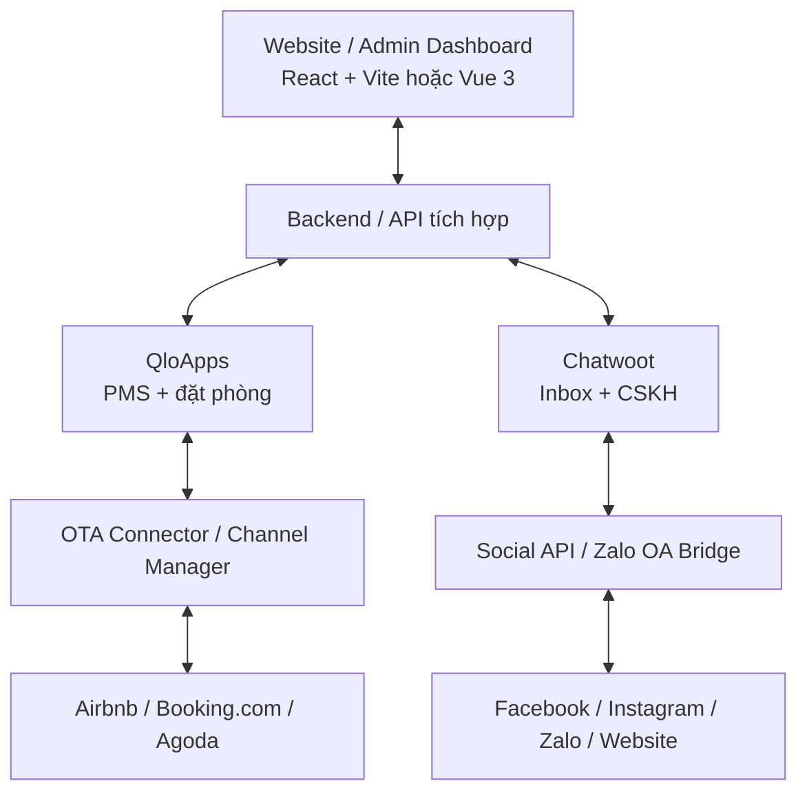

# Tổng hợp giải pháp mã nguồn mở quản lý Platform & Social

> Mục tiêu: lựa chọn mã nguồn mở có thể tự triển khai (self-host) và tùy chỉnh để xây dựng hệ thống quản lý lưu trú tương tự **GoHost / Hostfully**, kết hợp quản lý hội thoại khách hàng tương tự **Subiz**.
>
> Ngày tổng hợp: 17/10/2026.

## 1. Tổng quan nhu cầu

| Nhóm | Nền tảng tham chiếu | Nhu cầu trọng tâm | Hướng mã nguồn mở |
| --- | --- | --- | --- |
| Quản lý Platform / PMS | [GoHost](https://gohost.vn/) / [Hostfully](https://www.hostfully.com/) | Quản lý phòng/căn hộ, lịch đặt, khách hàng, giá, báo cáo, bán phòng đa kênh | **QloApps**, HotelDruid |
| Quản lý Social / CSKH | [Subiz](https://subiz.com.vn/) | Hộp thư đa kênh, live chat, nhân viên, phân công, tự động hóa, chăm sóc khách | **Chatwoot**, FreeScout, Zammad |

**Lưu ý quan trọng:** Có source code PMS không đồng nghĩa với việc đã có hệ thống Channel Manager đồng bộ hai chiều với Airbnb, Booking.com, Agoda. Kết nối OTA và nhiều kênh nhắn tin cần kiểm tra API, điều kiện đối tác, module/add-on và chi phí vận hành riêng.

## 2. Quản lý Platform (thay GoHost / Hostfully)

### 2.1. QloApps — ưu tiên khảo sát

- **Source:** https://github.com/Qloapps/QloApps
- **Website / demo:** https://qloapps.com/ · https://demo.qloapps.com/
- **Công nghệ:** PHP + MySQL.
- **Giấy phép:** OSL-3.0 (kiểm tra điều khoản trong phiên bản sử dụng).
- **Chức năng chính:**
  - Hệ thống quản lý khách sạn / lưu trú (PMS).
  - Quản lý phòng, loại phòng, số lượng phòng, giá và lịch đặt.
  - Quản lý khách đặt phòng và trạng thái booking.
  - Website / booking engine cho khách đặt phòng trực tiếp.
  - Các báo cáo và chức năng quản trị lưu trú.
  - Có phương án triển khai self-host, bao gồm tài liệu/cấu hình Docker.
- **Phù hợp khi:** Cần nền tảng PMS sẵn có để chỉnh sửa giao diện, bổ sung luồng vận hành homestay/villa và tích hợp kênh bán.
- **Hạn chế cần kiểm tra:** Channel Manager, đồng bộ OTA và một số chức năng nâng cao có thể là dịch vụ hoặc add-on riêng, không mặc định có trong core open-source.

### 2.2. HotelDruid

- **Source:** https://github.com/digital-druid/hoteldruid
- **Website:** https://www.hoteldruid.com/en/
- **Công nghệ:** PHP.
- **Giấy phép:** AGPL-3.0.
- **Chức năng chính:**
  - Quản lý phòng, lịch lưu trú và đặt phòng.
  - Quản lý khách, giá phòng, doanh thu và vận hành.
  - Tính năng quản trị liên quan đến nhân viên / bán hàng tùy cấu hình.
- **Phù hợp khi:** Muốn PMS truyền thống tương đối đầy đủ và có khả năng can thiệp source.
- **Hạn chế:** UI có thể cần thiết kế lại; Channel Manager của HotelDruid không nên mặc định xem là phần mã nguồn mở miễn phí.

### 2.3. So sánh nhanh

| Tiêu chí | QloApps | HotelDruid |
| --- | --- | --- |
| PMS / đặt phòng | Có | Có |
| Quản lý phòng, giá, khách | Có | Có |
| Website đặt phòng trực tiếp | Có | Có / tùy cấu hình |
| Dễ dùng làm nền tảng tùy biến mới | **Ưu tiên** | Cân nhắc |
| Đồng bộ OTA hai chiều miễn phí, đủ kênh | **Cần xác minh add-on/API** | **Cần xác minh module/API** |
| Source | [GitHub](https://github.com/Qloapps/QloApps) | [GitHub](https://github.com/digital-druid/hoteldruid) |

## 3. Quản lý Social (thay Subiz)

### 3.1. Chatwoot — ưu tiên khảo sát

- **Source:** https://github.com/chatwoot/chatwoot
- **Website:** https://www.chatwoot.com/
- **Công nghệ:** Ruby on Rails + Vue.
- **Giấy phép:** MIT cho phần Community (kiểm tra phạm vi tính năng theo phiên bản/edition).
- **Chức năng chính:**
  - Unified inbox / live chat website.
  - Hỗ trợ các kênh như Facebook, Instagram, WhatsApp và email theo cấu hình tích hợp.
  - Gán hội thoại cho nhân viên hoặc nhóm.
  - Quản lý liên hệ, ghi chú, quy trình chăm sóc khách.
  - Automation, báo cáo, phản hồi hỗ trợ khách hàng.
- **Phù hợp khi:** Cần giải pháp gần nhất với hộp thư CSKH đa kênh của Subiz, đồng thời muốn xây thêm CRM hoặc gắn vào PMS.
- **Hạn chế:** Zalo không nên được mặc định coi là tích hợp native; có thể cần bridge, API OA và công sức duy trì tích hợp.

### 3.2. FreeScout

- **Source:** https://github.com/freescout-help-desk/freescout
- **Công nghệ:** PHP / Laravel.
- **Giấy phép:** AGPL-3.0.
- **Chức năng chính:**
  - Hộp thư chung (shared inbox) cho đội CSKH.
  - Theo dõi hội thoại / ticket, nhân viên phụ trách, ghi chú và quy trình xử lý.
  - Có hệ sinh thái module để bổ sung chức năng.
- **Phù hợp khi:** Cần helpdesk nhẹ, tập trung email / ticket, quen hệ sinh thái Laravel.
- **Hạn chế:** Tính năng social đa kênh có thể cần module trả phí hoặc tích hợp thêm.

### 3.3. Zammad

- **Source:** https://github.com/zammad/zammad
- **Website:** https://zammad.com/
- **Công nghệ:** Ruby on Rails + Vue.
- **Giấy phép:** AGPL-3.0.
- **Chức năng chính:**
  - Helpdesk và ticket quản lý yêu cầu khách hàng.
  - Email, live chat, quy trình làm việc, phân quyền, nhóm hỗ trợ.
  - Quản lý SLA và hỗ trợ vận hành CSKH theo quy trình.
- **Phù hợp khi:** CSKH theo ticket/process quan trọng hơn mạng xã hội.
- **Hạn chế:** Không mặc định thay thế mọi kết nối mạng xã hội/Zalo của Subiz.

### 3.4. So sánh nhanh

| Tiêu chí | Chatwoot | FreeScout | Zammad |
| --- | --- | --- | --- |
| Inbox CSKH | Có | Có | Có |
| Live chat website | Có | Qua cấu hình/module | Có / tùy kênh |
| Mạng xã hội đa kênh | **Mạnh nhất trong 3 lựa chọn** | Cần module | Tùy tích hợp |
| Ticket / helpdesk | Có | Mạnh | **Mạnh** |
| Gắn với hệ thống PMS | Qua API/webhook/tùy biến | Qua API/module | Qua API/tùy biến |
| Zalo OA | Cần tích hợp riêng | Cần tích hợp riêng | Cần tích hợp riêng |
| Source | [GitHub](https://github.com/chatwoot/chatwoot) | [GitHub](https://github.com/freescout-help-desk/freescout) | [GitHub](https://github.com/zammad/zammad) |

## 4. Giải pháp bổ trợ cho Zalo

- **Repository tham khảo:** https://github.com/diendh/zca-bridge
- **Mục đích:** Tham khảo cách kết nối luồng tin nhắn Zalo với hệ thống khác/Chatwoot.
- **Việc cần kiểm tra trước khi sử dụng:** Tình trạng duy trì repository, hỗ trợ Zalo OA hay Zalo cá nhân, cơ chế xác thực, phạm vi API, giới hạn nhắn tin và tính hợp lệ theo chính sách Zalo.
- **Khuyến nghị:** Ưu tiên **API chính thức của Zalo OA** khi triển khai cho doanh nghiệp; tránh đặt tài khoản kinh doanh quan trọng vào các giải pháp dùng API cá nhân không chính thức.

## 5. Kiến trúc đề xuất: một hệ thống quản lý tập trung

### 5.1. Vai trò từng phần

1. **Dashboard riêng (React/Vue):** Một màn hình quản trị chung, nhận dữ liệu đặt phòng, khách hàng, cuộc hội thoại và báo cáo.
2. **QloApps:** Nguồn dữ liệu chính của phòng/căn hộ, giá, đặt phòng và lịch lưu trú.
3. **Chatwoot:** Trung tâm hội thoại và chăm sóc khách từ website / social.
4. **Integration backend:** Đồng bộ khách hàng, liên kết hội thoại với booking, webhook, phân quyền và API.
5. **OTA Connector:** Nhận/trả dữ liệu đặt phòng, tồn phòng và giá với các OTA trong phạm vi API/đối tác được cấp.
6. **Zalo OA / Social Bridge:** Nhận/gửi hội thoại qua API chính thức và kết nối về inbox.

### 5.2. Những tính năng nên phát triển thêm

- Liên kết một khách hàng giữa PMS và CRM, tránh trùng dữ liệu.
- Từ màn hình hội thoại xem được booking, ngày check-in/check-out, số phòng và trạng thái thanh toán.
- Tự động gửi xác nhận đặt phòng, hướng dẫn check-in, nhắc check-out, yêu cầu đánh giá khi được phép và có mẫu phù hợp.
- Dashboard tổng hợp công suất phòng, doanh thu, nguồn đặt phòng, thời gian phản hồi và chất lượng CSKH.
- Hệ thống quyền: chủ cơ sở, quản lý, lễ tân, CSKH, kế toán.
- Nhật ký thao tác, xử lý đồng bộ lỗi, backup và giám sát webhook.

## 6. Các hạn chế cần giải quyết trước khi thay thế hệ thống thương mại

### Kết nối OTA

- **Booking.com:** API Connectivity có yêu cầu về quyền truy cập và chương trình đối tác. Không mặc định được kết nối trực tiếp chỉ vì có source PMS.
- **Airbnb / Agoda:** Cần xác minh cơ chế kết nối hiện hành, cấp quyền, loại dữ liệu có thể đồng bộ và giới hạn kỹ thuật/đối tác.
- **Channel Manager:** Có thể cần sử dụng nhà cung cấp trung gian hoặc phát triển connector được cấp phép; đây là phần rủi ro kỹ thuật lớn nhất của hệ thống thay GoHost/Hostfully.

### Kênh social

- Facebook/Instagram/WhatsApp phải tuân thủ Meta API, quyền ứng dụng, kiểm duyệt và giới hạn nhắn tin.
- Zalo OA có quy tắc và giới hạn riêng; cần xác minh khả năng dùng API cho trường hợp kinh doanh cụ thể.
- Các module trả phí, điều kiện bản quyền và chính sách của nền tảng có thể thay đổi theo thời điểm.

### Vận hành self-host

- Phải triển khai HTTPS, backup database, kiểm soát truy cập và phân quyền.
- Cần theo dõi cập nhật bảo mật và tuân thủ giấy phép mã nguồn mở.
- Tích hợp PMS, Social và OTA nên đi qua API/webhook có hàng đợi, idempotency và cơ chế retry để tránh sai lệch đặt phòng.

## 7. Khuyến nghị triển khai

**Bộ source nên bắt đầu:** **QloApps + Chatwoot**.

| Giai đoạn | Việc thực hiện | Kết quả kỳ vọng |
| --- | --- | --- |
| 1. PoC | Dựng QloApps và Chatwoot trên môi trường test | Kiểm tra luồng đặt phòng và hội thoại |
| 2. Tích hợp nội bộ | Xây API chung, đồng bộ khách hàng và booking | Dashboard quản lý tập trung |
| 3. Social | Kết nối các kênh chính thức theo nhu cầu, ưu tiên website và Facebook, sau đó Zalo OA | Inbox tập trung có ngữ cảnh đặt phòng |
| 4. OTA | Xác minh quyền truy cập API / đối tác, thử nghiệm connector hoặc Channel Manager | Đồng bộ đặt phòng, giá, tồn phòng theo kênh được hỗ trợ |
| 5. Product hóa | Thiết kế lại UI, quyền người dùng, báo cáo, tự động hóa, giám sát | Hệ thống quản lý homestay/villa thống nhất |

**Kết luận:** QloApps cung cấp phần nền PMS; Chatwoot cung cấp phần nền Social/CSKH. Đây là bộ đôi phù hợp để bắt đầu một sản phẩm tự host và tùy biến. Tuy nhiên, để đạt mức tương đương GoHost/Hostfully/Subiz trong vận hành thật, cần kiểm chứng kỹ hai mảng khó nhất là **đồng bộ OTA hai chiều** và **kết nối Zalo/social theo API chính thức**.

## 8. Danh sách liên kết đầy đủ

### Các nền tảng tham chiếu

- GoHost: https://gohost.vn/
- Hostfully: https://www.hostfully.com/
- Subiz: https://subiz.com.vn/

### PMS / Platform

- QloApps: https://github.com/Qloapps/QloApps
- QloApps Demo: https://demo.qloapps.com/
- HotelDruid: https://github.com/digital-druid/hoteldruid

### Social / CSKH

- Chatwoot: https://github.com/chatwoot/chatwoot
- FreeScout: https://github.com/freescout-help-desk/freescout
- Zammad: https://github.com/zammad/zammad
- Zalo bridge (tham khảo): https://github.com/diendh/zca-bridge

---

*Tài liệu định hướng lựa chọn mã nguồn. Tình trạng repository, license, tính năng miễn phí/trả phí và điều kiện kết nối API cần được xác minh trước khi áp dụng cho hệ thống production.*
